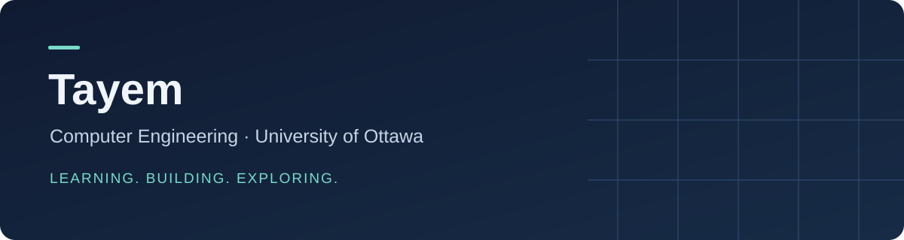

# Hi, I'm Tayem

I'm a first-year Computer Engineering student at the University of Ottawa, developing my skills in C programming, algorithms, and software development.

## What I'm Learning

**C programming** · Arrays and pointers · Structures · Searching and sorting · Numerical methods

I'm also learning to organize and document my work using GitHub.

## Selected Coursework

| Project | What I worked on |
|---|---|
| **Student Record Analysis and Sorting** | Processing simulated student records, calculating weighted grades, and sorting by multiple criteria. |
| **Geometry Programs** | Sorting circles, checking overlap, calculating triangle perimeters, and working with structures. |
| **Circular Array Shifting** | Implementing array rotations using pointers and separate functions. |

Coursework solutions are maintained in a private repository. These exercises include course-provided material and completed implementations; attribution and limitations are documented alongside the code.

## Research Interests

I'm interested in exploring **artificial intelligence, cybersecurity, and software engineering**, and looking for opportunities to contribute and learn through undergraduate research.

## Currently Working On

- Improving input validation and handling edge cases.
- Testing my programs and documenting their limitations.
- Building a stronger foundation in algorithms and software development.
